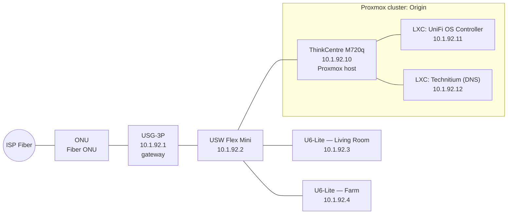

# Network Diagrams

Source of truth: NetBox. Regenerate this file whenever devices, cabling, or VLANs
change in NetBox — it is a snapshot, not authoritative.

Sites:
- **Origin** — flat LAN, no VLANs, Ubiquiti gear + Proxmox host
- **Home** — VLAN-segmented, Victim router/firewall (CARP VIPs) + MikroTik MLAG core, Mausoleum NAS

---

## Site: Origin

Flat network, no VLAN segmentation. Subnet `10.1.92.0/24`.

**Locations:** Living Room (USG-3P, USW Flex Mini, U6-Lite, ThinkCentre M720q, ONU), Farm (U6-Lite — Farm).

---

## Site: Home

Core routing/firewall is a **CARP pair**: **Victim** (Qotom J4125, "GeoFront") and **Demiurg**, both
active, with a dedicated pfsync link between them (`igc4` on both). Each router has an LACP bond (`igc2`+`igc3`) into the
MLAG pair (Victim lands on `port1` of Aura and Mare, Demiurg on `port2`). The bond is a full trunk: it
carries every VLAN tagged (2, 3, 10, 15, 20, 25, 500) and ignores untagged traffic. Core
switching is the MLAG pair (**Aura** + **Mare**, MikroTik CRS310), CARP-fronted gateway for 5 VLANs.
The **fiber ONT** (on the Mausoleum shelf) reaches Aura `ether3` (WAN VLAN 2) through patch panel port 1
and the **Starlink** terminal (outside) reaches Mare `ether3` (WAN VLAN 3) through patch panel port 2;
both VLANs are carried across the MLAG pair to Victim and Demiurg.
**Sebas Tian** (CSS326) is the access switch, uplinked to the pair via MC-LAG (Aura `sfp-sfpplus2` and Mare `sfp-sfpplus2`); the KVM/IPMI ports
are on Sebas Tian `ether5` (Victim), `ether6` (Demiurg) and `ether7` (Mausoleum), through the patch panel.
A **Shadow** PoE camera switch and the **Frigate** NVR sit in a separate rack that is not tracked at the
moment; a single cable from that rack comes down to patch panel port 9 and lands on Sebas Tian `ether9`
(untagged CCTV VLAN 25).
**Mausoleum**'s `eth0`+`eth1` are bonded (`bond0`, LACP) into the MLAG pair on `ether4` of Mare and
Aura, tagged Lab VLAN 10 — this is its LAN uplink. VLAN 10 and the WAN-facing path run standard
MTU 1500.
The three **MAGI** Talos nodes (**Balthasar**, **Casper**, **Melchior**) are cabled with a direct DAC
mesh between them that carries the cluster BGP plane (no switch involved). Each node's management,
egress and control-plane VIP use an LACP bond (`bond-up`, 2.5G ports) into the Aura/Mare MLAG pair on VLAN 10 (Balthasar `ether5`, Casper `ether6`, Melchior `ether7` on both switches). See [talos-bgp.md](talos-bgp.md).
Aura, Mare and Sebas Tian live in the Office rack ("Nazarick").

### Patch panel

Rear = what is cabled to the panel, front = where the panel lands. Ports 10, 11 and 14-24 are unused.

| Port | Rear (device)                  | Front (switch port)                     |
|-----:|---------------------------------|-------------------------------------------|
| 1    | Fiber ONT                       | Aura `ether3` (WAN VLAN 2, untagged)      |
| 2    | Starlink terminal               | Mare `ether3` (WAN VLAN 3, untagged)      |
| 3    | Zigbee Bridge PoE injector      | Sebas Tian `ether2` (IoT VLAN 20)         |
| 4    | Tsuare PoE injector             | Sebas Tian `ether3` (trunk)               |
| 5    | Pestonya PoE injector           | Sebas Tian `ether4` (trunk)               |
| 6    | Victim KVM                      | Sebas Tian `ether5` (Mgmt VLAN 500)       |
| 7    | Demiurg KVM                     | Sebas Tian `ether6` (Mgmt VLAN 500)       |
| 8    | Mausoleum KVM                   | Sebas Tian `ether7` (Mgmt VLAN 500)       |
| 9    | Cable from the other rack       | Sebas Tian `ether9` (CCTV VLAN 25)        |
| 12   | BeQuiet                         | Sebas Tian `ether12` (Mgmt VLAN 500)      |
| 13   | NUT Server                      | Sebas Tian `ether14` (Lab VLAN 10)        |

Sebas Tian `ether24` is a spare management port (untagged Mgmt VLAN 500).

### Full Topology

Everything on the Home site in one diagram, logical links only (patch panel and PoE
injectors are physical and live in NetBox): WAN uplinks, the core MLAG fabric, the access
layer (**Sebas Tian**, **Shadow**), Mausoleum (NAS), and the wired endpoints off Sebas Tian.

```mermaid
graph TB
    subgraph WAN ["WAN"]
        Starlink((Starlink)) --- StarlinkTerm["Starlink Terminal"]
        FiberISP((Fiber - Metrocom))
    end

    subgraph Core ["Core routing / switching fabric"]
        Victim["Victim (GeoFront)\nQotom J4125\nCARP firewall/router"]
        Mare["Mare\nCRS310-8G+2S+IN\n10.0.0.6\nfd7a:2201:5e72::6"]
        Aura["Aura\nCRS310-8G+2S+IN\n10.0.0.5\nfd7a:2201:5e72::5"]

        Victim ---|"igc3 → Mare port1\n(LACP member, downstream bond)"| Mare
        Victim ---|"igc2 → Aura port1\n(LACP member, downstream bond)"| Aura
        Aura ===|"sfp-sfpplus1 ↔ sfp-sfpplus1\nMLAG peer link (cyan fiber)"| Mare
    end


    FiberISP --- ONT
    ONT ---|"patch panel 1 → ether3\nWAN VLAN 2"| Aura
    StarlinkTerm ---|"patch panel 2 → ether3\nWAN VLAN 3"| Mare

    subgraph Access ["Access layer"]
        SebasTian["Sebas Tian\nCSS326-24G-2S+RM\n10.0.0.8"]
        Shadow["Shadow\nZKTeco PE162-200-C\nPoE camera switch"]
    end

    Aura ---|"sfp-sfpplus2 ↔ Sebas Tian sfp-sfpplus1\nMC-LAG member (cyan fiber)"| SebasTian
    Mare ---|"sfp-sfpplus2 ↔ Sebas Tian sfp-sfpplus2\nMC-LAG member (cyan fiber)"| SebasTian
    SebasTian ---|"patch panel 9 → ether9\nuntagged CCTV VLAN 25\nother rack, not tracked"| Shadow

    Demiurg["Demiurg\nCARP firewall/router\nactive pair with Victim"]
    Victim ===|"igc4 ↔ igc4\npfsync"| Demiurg
    Aura ---|"port2 ← igc2\nLACP member, downstream bond"| Demiurg
    Mare ---|"port2 ← igc3\nLACP member, downstream bond"| Demiurg
    SebasTian ---|"patch panel 7 → ether6\nKVM/IPMI (kvm0)"| Demiurg
    SebasTian ---|"patch panel 6 → ether5\nKVM/IPMI (kvm0)"| Victim


    subgraph Shelf ["Compute shelf"]
        Mausoleum["Mausoleum (Beelink ME Pro)\nNAS — bond0: 10.1.0.15\nfd7a:2201:1ab::15\nkvm0: 10.0.0.15"]
        ONT["Fiber ONT"]
    end

    Aura ===|"ether4 ↔ eth0/eth1\nbond0 member, LACP MLAG, tagged Lab VLAN 10\nLAN uplink, MTU 1500"| Mausoleum
    Mare ===|"ether4 ↔ eth0/eth1\nbond0 member, LACP MLAG, tagged Lab VLAN 10\nLAN uplink, MTU 1500"| Mausoleum
    SebasTian ---|"patch panel 8 → ether7\nkvm0, untagged Mgmt VLAN 500"| Mausoleum

    subgraph MAGI ["MAGI Talos nodes"]
        Balthasar["Balthasar\nlo 10.1.3.11/32\nbond-up 10.1.0.11"]
        Casper["Casper\nlo 10.1.3.12/32\nbond-up 10.1.0.12"]
        Melchior["Melchior\nlo 10.1.3.13/32\nbond-up 10.1.0.13"]
    end

    Balthasar ===|"eno2 ↔ eno2, 10.1.3.0/31\nBGP mesh, MTU 1500"| Casper
    Balthasar ===|"eno1 ↔ eno2, 10.1.3.2/31\nBGP mesh, MTU 1500"| Melchior
    Casper ===|"eno1 ↔ eno1, 10.1.3.4/31\nBGP mesh, MTU 1500"| Melchior

    subgraph Endpoints ["Wired endpoints (Sebas Tian)"]
        BeQuiet["BeQuiet\nworkstation\n10.0.0.100\nfd7a:2201:5e72::100"]
        Zigbee["Zigbee Bridge"]
        Tsuare["Tsuare (cAP ax)\n10.0.0.9\nfd7a:2201:5e72::9"]
        Pestonya["Pestonya (cAP ax)\n10.0.0.10\nfd7a:2201:5e72::10"]
        NUT["NUT Server\n10.1.0.20\nfd7a:2201:1ab::20"]
        Frigate["Frigate (ThinkCentre M900 Tiny)\nNVR — 172.16.25.200"]
    end

    SebasTian ---|"patch panel 12 → ether12\nuntagged Mgmt VLAN 500"| BeQuiet
    SebasTian ---|"patch panel 3 → ether2\nuntagged IoT VLAN 20"| Zigbee
    SebasTian ---|"patch panel 4 → ether3\ntrunk: Home/IoT/CCTV/Mgmt"| Tsuare
    SebasTian ---|"patch panel 5 → ether4\ntrunk: Home/IoT/CCTV/Mgmt"| Pestonya
    SebasTian ---|"patch panel 13 → ether14\nuntagged Lab VLAN 10"| NUT
    SebasTian ---|"patch panel 9 → ether9\nuntagged CCTV VLAN 25\nother rack, not tracked"| Frigate
```

### VLAN Legend (Home site)

| VLAN | Name  | Purpose                              | IPv4 prefix      | IPv6 prefix          |
|-----:|-------|---------------------------------------|-------------------|------------------------|
| 2    | WAN A | Fiber transit, L2 only (patch panel 1, Aura ether3)    | — | — |
| 3    | WAN B | Starlink transit, L2 only (patch panel 2, Mare ether3) | — | — |
| 10   | Lab   | Cluster frontend, VMs, node mgmt      | 10.1.0.0/24       | fd7a:2201:1ab::/64     |
| —    | (K8s LB) | Cilium LoadBalancer pool, BGP-only, no L2 | 10.1.1.0/24   | fd7a:2201:1ac::/64     |
| —    | (MAGI mesh) | Routed DAC point-to-point links + node loopbacks, no L2, MTU 1500 | 10.1.3.0/28 | fd7a:2201:1ad::/64 |
| 15   | Home  | Trusted clients                       | 172.16.15.0/24    | fd7a:2201:ca5a::/64    |
| 20   | IoT   | Untrusted smart devices               | 172.16.20.0/24    | —                       |
| 25   | CCTV  | Cameras (PoE switch)                  | 172.16.25.0/24    | —                       |
| 500  | Mgmt  | Network infra (switches, APs)         | 10.0.0.0/24       | fd7a:2201:5e72::/64    |

Full device/IP breakdown per VLAN is in [ipam.md](ipam.md).
